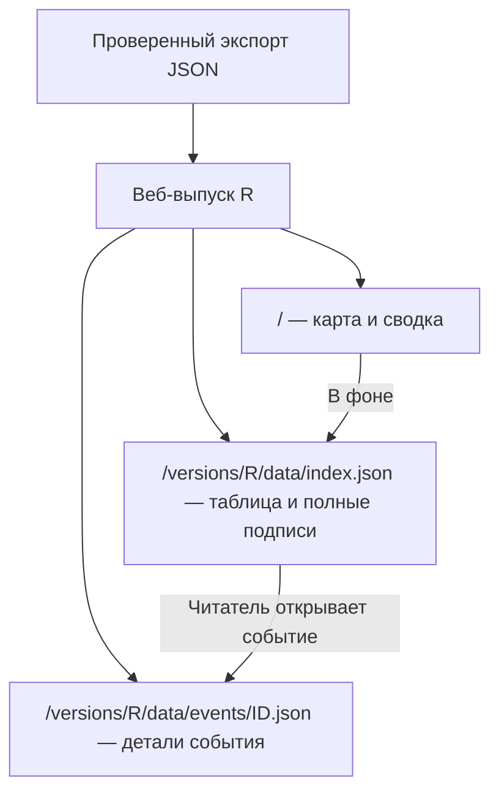

# План выкатки дашборда покрытия на Hetzner

Составлен 2026-11-05. Обновлён 2026-11-10 после проверки первой загрузки.

## Решение и текущие границы

**Дашборд публикуется для всех желающих, без логина и пароля.**
Расчёты выполняются на Mac. Сервер раздаёт входную страницу и файлы данных по HTTPS.
Подключение публикации к Dagster и перенос обработки на сервер можно отложить.

- Отдельный сервер запросов к базе сейчас не нужен. dbt считает показатели заранее, а браузер
  переключает виды и фильтрует готовые данные. Такой способ работает и с несколькими JSON-файлами.
  Сервер вычислений стоит обсуждать, когда появится нужный расчёт, который браузер не сможет выполнить
  на доступных ему данных.
- На Mac уже есть ручная задача Dagster `static_refresh`: проверка входов → загрузка DuckDB →
  `dbt build` с тестами → копия базы для Metabase. Экспорт JSON и сборка HTML пока запускаются отдельно.
  Расписания нет; см. [docs/dagster.md](dagster.md).
- Neo хранит векторы Qwen3 и участвует в подготовке новых сопоставлений постов с событиями.
  Для пересборки сайта из уже готовых наборов сопоставлений Neo и векторы не нужны.
- Metabase остаётся отдельным локальным потребителем данных. На сайт выкладываем статический выпуск.
- Для сервера без подходящего веб-сервера предлагается Caddy: раздача файлов и автоматический HTTPS.
  Если сайты уже обслуживает другой веб-сервер, сначала проверяем возможность использовать его.
  Установку Caddy не считаем обязательной до проверки сервера.

Для текущей настройки владелец выбрал существующий `m4-pilot`; новый сервер не покупаем.
DNS и HTTPS подготовлены и проверены. Владелец подтвердил публикацию самого дашборда без пароля.
Первоначальный закрытый показ больше не является выбранным режимом доступа.

**Сборка от 2026-11-06:** `https://askmedia.news`, версия `20261106T184425Z-30cc1f6d`.
Открытие страницы не требует авторизации. Опубликован основной `coverage_dashboard.html`, собранный
из свежего шаблона Claude: дизайн из [PR №5](https://github.com/alex-badin/events_coverage/pull/5)
и исправления подписей из [PR №6](https://github.com/alex-badin/events_coverage/pull/6), исходная ревизия `3d1b180`.
Дизайн включает общую таблицу обзора и недели, колонку ФОМ, относительные цвета и выбор периода.
Экспорт данных не менялся. Шаблон сохранён в `dashboard/coverage_dashboard_template.html`;
временный файл `_pr5` больше не нужен для повторения этой сборки.

**Веб-выпуск от 2026-11-10:** `20261110T183154Z-52eb1ad5`. Он использует тот же снимок с
637 измеренными событиями. Главная страница занимает 52 223 байта с gzip. Индекс таблицы
занимает 372 957 байт, самый большой файл события — 13 264 байта. Веб-выпуск содержит 4 601 файл
деталей. Сжатые файлы всего выпуска занимают около 7,49 МБ.
Предыдущий выпуск сохранён. Запись для отката находится в
`/root/events-coverage-backups/deploy-20261110T183154Z-52eb1ad5/current.before`.

## Выбранное размещение: существующий сервер — 2026-11-06

**Для нынешнего дашборда отдельный сервер не требуется.** После вопроса о более простом решении
проверен уже оплаченный `m4-pilot`: доступно 7 080 МиБ памяти и 62 ГБ диска, средняя нагрузка за минуту — 0,08.
Это состояние на момент проверки 2026-11-06, а не обещание постоянного запаса.
Для небольшой раздачи готовых файлов ресурсов достаточно; Caddy уже установлен.

Владелец подтвердил открытый сайт `askmedia.news` на существующем сервере.
Дополнительная аренда машины не потребуется. Текущие расходы на сервер и DNS сохраняются;
превышение включённого трафика оплачивается отдельно.

Текущий M4 обслуживается через Cloudflare Tunnel: Caddy слушает `127.0.0.1:8080`,
приложение — `127.0.0.1:8000`. Этот блок Caddy сохранён байт в байт; добавлен только импорт отдельного сайта.
Для нового сайта Caddy теперь слушает 80/443. Hetzner Firewall уже разрешал оба порта для IPv4 и IPv6;
его четыре правила не менялись. SSH, UFW и настройки приложения M4 также не менялись.

Что было проверено при настройке 6 ноября:

- [`scripts/prepare_dashboard_host.sh`](../scripts/prepare_dashboard_host.sh) применён к выбранному серверу.
  Он проверил полную конфигурацию Caddy до reload и сохранил исходные файлы для отката.
- [`configs/deploy/askmedia.Caddyfile`](../configs/deploy/askmedia.Caddyfile) задаёт отдельный открытый сайт.
  Он не содержит авторизацию и не запрашивает пароль. Публичная конфигурация применяется при выкладке.
- Ссылка `current` указывала на `/var/www/coverage/releases/20261106T184425Z-30cc1f6d`.
  В версии находятся только `index.html` и `index.html.gz`.
  Предыдущий открытый дашборд `20261106T164622Z-6f47ff32` сохранён для отката.
- Пароль первоначальной заглушки больше не используется публичной конфигурацией.
  Старый файл с паролем не переносится в папку сайта или в репозиторий.
- Резервная копия и журналы проверок находятся на сервере в
  `/root/events-coverage-backups/setup-20261106T141434Z.wvvEvX`.
- После применения Caddy и `cloudflared` активны. Входная страница M4 на локальном порту возвращает прежний `302`.
  Это проверка доступности входной страницы, а не всех функций приложения.
- Внешний HTTP-запрос с именем `askmedia.news` возвращает `308` на HTTPS.
  Получен сертификат Let's Encrypt для `askmedia.news`, действующий до 2027-02-04.
  Проверка сертификата и имени домена успешна; проверка TLS не отключалась.
- Внешние запросы к странице и к `/index.html.gz` возвращают `200` без `WWW-Authenticate`.
  Страница передаётся с `Content-Encoding: gzip`; распакованное содержимое совпадает с локальным HTML.
  HTML — 43 349 941 байт, gzip — 5 559 500 байт.
- Внешний IPv4 проверен с Mac через обычный DNS. При первой публичной выкладке внешний IPv6 проверен точкой Globalping:
  адрес совпал с AAAA, проверка сертификата успешна, ответ без пароля — `200`.
  [Результат IPv6-проверки публичной версии](https://api.globalping.io/v1/measurements/2NHusGU4MvucYt6XP00021SHf).
  Пароли сервису проверки не передавались.
- Для нового дизайна локально проверены выбор года, таблица недели, фильтр группы, справка
  и событие без расчёта с цитатами ФОМ. На публичном сайте проверены новый дизайн, обзор, неделя,
  выбор года и фильтр группы. Ошибок JavaScript при этих действиях не было.
  Основной блок Caddy M4 не изменился, локальная входная страница M4 возвращает прежний `302`.

Резервная копия выкладки от 6 ноября находится в
`/root/events-coverage-backups/deploy-20261106T184425Z-30cc1f6d`:
`site.before` — прежний блок сайта, `current.before` — прежняя цель ссылки.
В этой ранней схеме откат возвращал предыдущий открытый дашборд `20261106T164622Z-6f47ff32`.
Порядок отката веб-выпусков с отдельными файлами описан ниже.
Резервная копия самой первой публикации сохранена отдельно в
`/root/events-coverage-backups/deploy-20261106T164622Z-6f47ff32`; она относится к первоначальной закрытой заглушке.
Отдельная машина остаётся запасным вариантом; подготовленный cloud-init к `m4-pilot` не применяется.

## Запасной вариант: подготовленный заказ нового сервера — 2026-11-06

Форма нового сервера заполнена до кнопки `Create & Buy now`; покупка не выполнена.
Этот вариант сохраняется для выбора владельца, а не является необходимым условием публикации.
Storage Box для резервных копий не заменяет сервер с Linux.

| Параметр | Выбор | Причина |
|---|---|---|
| Тариф | CPX02: 1 AMD vCPU, 1 ГБ памяти, 20 ГБ диска | Сервер раздаёт готовые файлы; расчётов и базы на нём нет |
| Расположение | Helsinki, `hel1` | Доступный европейский регион |
| ОС | Ubuntu 24.04 LTS | Поддерживаемая стабильная версия с обычными пакетами Linux |
| Имя | `events-coverage` | Назначение видно в списке ресурсов |
| Сеть | Публичные IPv4 и IPv6, без частной сети | Доступ зрителям и с Mac; IPv4 нужен и для сетей без IPv6 |
| Вход по SSH | Существующий ключ `m4-pilot-mac`; отдельный пользователь `deploy` в сценарии подготовки | Пароли для SSH не нужны; закрытый ключ остаётся на Mac |
| Веб-адрес | **`askmedia.news` в корне**, без поддомена | После обсуждения выбран прямой адрес отдельного проекта |
| Дополнительные услуги | Без Volumes, Load Balancer и платных Backups | Готовые файлы и сценарий подготовки сохраняются локально |
| Сетевой экран | UFW на новом сервере: только входящие TCP 22, 80, 443 | Существующий Firewall другого сервера не меняется |
| Первая настройка | [`configs/deploy/hetzner-cloud-init.yaml`](../configs/deploy/hetzner-cloud-init.yaml) | Встроенный cloud-init выполнит сценарий при первом запуске после покупки |

Цена, показанная консолью Hetzner: **$8,09 в месяц без НДС** — $7,49 за сервер и $0,60 за IPv4.
Цена и наличие могут измениться до покупки. В проверенной форме CX23 и CAX11 не выбирались:
консоль сообщала об отсутствии доступного варианта. CPX12 стоил $13,49 без IPv4;
доплата за память для нынешней раздачи файлов не нужна.

Cloud-init — встроенный механизм подготовки Linux, а не новая система сборки проекта.
Он нужен, чтобы установка Caddy и создание папок повторялись из сохранённого файла.
Простая альтернатива — выполнить те же команды вручную после покупки. Docker для этого не требуется.
Пока сервер не куплен, сценарий существует только как подготовленная конфигурация: ОС, SSH и HTTPS ещё не проверены.
Этот сценарий предназначен **только для новой машины**. Не применять его к `m4-pilot`:
он устанавливает свою конфигурацию Caddy и параметры ОС вместо существующих.

### Домен в AWS

Регистрация домена остаётся в AWS. Публичная проверка DNS подтвердила серверы имён Route 53:
`ns-1555.awsdns-02.co.uk`, `ns-810.awsdns-37.net`, `ns-376.awsdns-47.com`, `ns-1432.awsdns-51.org`.
На момент проверки у корня `askmedia.news` не было ответов A и AAAA.
Это проверка публичного DNS, а не аудит всех записей зоны в аккаунте AWS.

Для выбранного `m4-pilot` адреса уже известны: IPv4 `159.69.252.89`, IPv6 `2a01:4f8:c016:3da6::1`.
Подготовлены только эти добавления к корню домена, TTL 300 секунд:

| Имя | Тип | Значение |
|---|---|---|
| `askmedia.news` | A | `159.69.252.89` |
| `askmedia.news` | AAAA | `2a01:4f8:c016:3da6::1` |

После входа владельца изменения применены в существующей публичной зоне `Z03237923NBMSHY4360QD`.
До изменения в зоне были только NS и SOA. Обе служебные записи сохранены;
созданы только A и AAAA из таблицы. Зона `letsaskmedia.com` не менялась, новая платная зона не создавалась.

Изменение `C0408182231LGZD13J6N6` в AWS получило статус `INSYNC` 2026-11-06.
Серверы Route 53 и Google DNS возвращают оба новых адреса с TTL 300.
Сервер видит новые записи и получил сертификат. Первоначальная заглушка проверена по HTTPS;
для опубликованного дашборда авторизация не используется.

Первоначальный старый ответ DNS мобильного подключения Mac обновился к публичной выкладке.
Обычный DNS на Mac возвращает оба адреса, и браузер открывает сайт. Настройки сети Mac для этого не менялись.

Сведения о первоначальных записях и подтверждение AWS сохранены локально в
`outputs/hetzner_setup/route53-before.txt`, `route53-after.txt` и `route53-change-status.txt`.
Текущие отчёты: `public-http-checks.json`, `public-ipv6-check.json`, `last-deploy.json`, `setup-status.json`.
Файлы `https-checks.json` и `ipv6-external-check.json` относятся к прежней закрытой заглушке.
Зависимости проекта не менялись; временный SDK использовался только для проверки локальных профилей до входа в консоль.

Откат DNS: если A и AAAA всё ещё содержат значения из таблицы, удалить только эти две добавленные записи.
NS и SOA оставить прежними. Новый сервер не куплен и для выбранного размещения не требуется.

### Доступ зрителя

Адрес — `https://askmedia.news`. Опубликованный дашборд доступен всем без логина и пароля.
Короткими ссылками после `#` можно делиться: они открывают выбранную неделю или событие.

## Схема первой выкладки от 6 ноября

Сплошные стрелки показывают путь очередной сборки сайта. Пунктирная ветка нужна только при подготовке
новых сопоставлений для исследования, а не при каждой публикации.

```mermaid
flowchart TB
    MATCH["Mac + Neo: подготовка новых сопоставлений<br/>Отдельная задача при расширении исследования"]

    subgraph MAC["1. Mac — ручная пересборка"]
        INPUTS["Новости + события ФОМ + группы СМИ<br/>Готовые наборы сопоставлений"]
        CHECK["Проверка читаемости входных файлов"]
        DB["DuckDB: загрузка таблиц<br/>dbt: расчёт показателей + тесты"]
        JSON["Экспорт dashboard_data.json"]
        HTML["Сборка coverage_dashboard.html<br/>Страница + код + данные в одном файле"]
        PACK["Новая временная папка<br/>index.html + index.html.gz"]
        INPUTS --> CHECK --> DB
        DB -->|"Успешная сборка и проверки"| JSON
        JSON --> HTML --> PACK
    end

    subgraph SERVER["2. Hetzner — хранение и публикация"]
        RELEASE["Новая папка releases/R<br/>R — уникальная версия выкладки"]
        VERIFY["Проверка загруженных файлов"]
        CURRENT["Переключение ссылки current на R<br/>Предыдущая версия сохранена для отката"]
        WEB["Веб-сервер: Caddy или существующий"]
        RELEASE --> VERIFY --> CURRENT --> WEB
    end

    subgraph USER["3. Браузер зрителя"]
        PAGE["Любой зритель получает HTML по HTTPS<br/>При поддержке gzip — сжатую копию"]
        VIEW["Распаковывает страницу и показывает дашборд<br/>Фильтры и переходы работают на полученных данных"]
        PAGE --> VIEW
    end

    MATCH -. "Готовые наборы сопоставлений" .-> INPUTS
    PACK -->|"rsync через SSH: только два файла"| RELEASE
    WEB --> PAGE
```



Что обновляется и где:

| Место | Что меняется при обновлении | Что запускает обновление |
|---|---|---|
| Mac: входные данные | Новые подготовленные данные, группы или наборы сопоставлений, если они появились | Отдельная работа с данными; первая выкладка использует существующие входы |
| Mac: рабочая база | DuckDB получает исходные таблицы; dbt пересчитывает показатели и проверяет их | Ручной запуск `static_refresh` либо команд из следующего раздела |
| Mac: файлы сайта | Новый JSON, новый HTML и соответствующая ему `.gz`-копия | Экспорт, сборка и упаковка |
| Hetzner | Новая папка версии; после проверки ссылка `current` указывает на неё | Отдельная команда публикации с Mac |
| Браузер | Получает опубликованный снимок при открытии или перезагрузке страницы | Действие зрителя; уже открытая страница сама не обновляется |

Через SSH не передаются архив новостей, DuckDB, векторы, `.env` или весь репозиторий.
Сервер не запускает dbt и не вызывает платные модели. Открытие события в браузере тоже не запускает расчёт.

## Что нужно для первой выкладки

### 1. Выбрать адрес и проверить сервер

Выбран корень `askmedia.news`. Владелец подтвердил публичный доступ к дашборду,
включая существующие отрывки постов и цитаты ФОМ из экспорта.

1. Проверить ОС сервера, занятость портов 80/443 и действующий способ обслуживания сайтов.
   Добавить сайт в существующую конфигурацию, если она подходит. Не заменять её вслепую.
2. Настроить DNS корня `askmedia.news` на сервер. Для HTTPS открыть нужные порты в действующих межсетевых экранах,
   включая Hetzner Firewall, если он используется.
3. Если выбран Caddy, установить поддерживаемую версию по
   [официальной инструкции](https://caddyserver.com/docs/install). На выбранном сервере Caddy уже установлен.
4. Подготовить `/var/www/coverage/releases`. Пользователь выкладки должен иметь право писать туда,
   а веб-сервер — читать файлы и проходить по родительским папкам.

Папки первой выкладки:

```text
/var/www/coverage/
├── releases/
│   ├── R1/
│   │   ├── index.html
│   │   └── index.html.gz
│   └── R2/
│       ├── index.html
│       └── index.html.gz
└── current -> releases/R2
```

`R1` и `R2` обозначают уникальные имена версий. Ссылка `current` выбирает версию, доступную зрителю.
На сервере нужны только готовые файлы сайта и настройка веб-сервера.

### 2. Настроить открытый сайт по HTTPS

Публичный блок сайта подключён из `/etc/caddy/sites/askmedia.news.caddy`.
Существующий блок M4 остаётся в `/etc/caddy/Caddyfile`. Раздача опубликованной версии выглядит так:

```caddyfile
askmedia.news {
    root * /var/www/coverage/current
    file_server {
        precompressed gzip
    }
}
```

Перед применением проверить конфигурацию командой
`sudo caddy validate --config /etc/caddy/Caddyfile --adapter caddyfile`.
Для установки через systemd применить проверенную конфигурацию командой `sudo systemctl reload caddy`.

`precompressed gzip` позволяет отдать готовый `.gz`, если браузер принимает gzip.
Если сжатой копии нет, эта конфигурация отдаёт обычный файл; сжатие на лету здесь не включено.
Пароль не требуется. Подробнее:
[готовые сжатые файлы](https://caddyserver.com/docs/caddyfile/directives/file_server),
[автоматический HTTPS](https://caddyserver.com/docs/automatic-https).

### 3. Подготовить и проверить локальную сборку

Из корня репозитория выполнить шаги по порядку. После неудачного шага не переходить к следующему.
Перед загрузкой и dbt закрыть отдельные соединения с рабочей DuckDB, чтобы не получить блокировку файла.

```sh
.venv/bin/python scripts/check_inputs.py
.venv/bin/python scripts/load_warehouse.py
(cd dbt && ../.venv/bin/dbt build)
.venv/bin/python scripts/export_dashboard_data.py
.venv/bin/python dashboard/build_dashboard.py
```

Проверка входов подтверждает, что исходные файлы читаются. Загрузчик обновляет таблицы DuckDB.
dbt строит показатели и запускает тесты. Экспорт сохраняет снимок показателей в JSON.
Сборщик соединяет этот JSON и шаблон страницы в `outputs/dashboard_exports/coverage_dashboard.html`.

Для первых трёх шагов также можно вручную использовать существующий `static_refresh`;
он дополнительно обновляет локальную копию базы для Metabase. Экспорт и сборку HTML затем выполнить отдельно.
Не запускать оба способа пересборки подряд без причины.

Продолжать после успешного dbt без неразобранных предупреждений; текущие предупреждения описаны
в [dashboard/README.md](../dashboard/README.md). Открыть HTML локально и проверить обзор, неделю,
измеренное событие с постами и событие без рассчитанного покрытия с цитатами респондентов.

### 4. Публикация и откат

Скрипт собирает веб-версию из проверенного `outputs/dashboard_exports/dashboard_data.json`.
Сбор данных и пересчёт базы выполняются отдельно. `DEPLOY_DATA` позволяет явно выбрать экспорт.

```sh
DEPLOY_HOST=m4-pilot zsh scripts/deploy_dashboard.sh
```

1. Скрипт создаёт уникальный выпуск и сжатую копию каждого файла. Он сверяет распакованные
   файлы с исходными и сохраняет контрольные суммы.
2. Скрипт передаёт выпуск во временный каталог по SSH. Сервер сверяет состав и контрольные
   суммы файлов. После проверки каталог становится доступен по адресу выпуска.
3. Скрипт проверяет прежнюю главную страницу и новый маршрут данных по HTTPS. Затем он
   переключает `current` на новый выпуск одним переименованием ссылки.
4. Скрипт проверяет главную страницу и доступность M4. При сбое после переключения он возвращает
   прежнюю ссылку `current`. Маршрут данных и файлы обоих выпусков остаются доступны открытым вкладкам.
   При сбое настройки до переключения скрипт восстанавливает предыдущий блок Caddy.

Для ручного отката возьмите цель ссылки из `current.before` в каталоге резервной копии этого выпуска.
Переключите `current` на неё атомарным переименованием. Проверьте главную страницу, файлы обоих выпусков и M4.
Сохраняйте каталоги опубликованных выпусков для открытых вкладок. Не перезаписывайте файлы внутри выпуска.

### 5. Проверка в браузере

Откройте главную страницу свежим запросом. Убедитесь, что карта и сводка видны во время загрузки таблицы.
Проверьте прямую ссылку на событие, фильтр группы, посты и цитаты события без расчёта.
На HTTPS проверьте сжатие HTML и JSON. Главная страница перепроверяется, а файлы выпуска кешируются
по своему адресу. Прямой `/data/index.json` должен вернуть `404`.

## Что загружается при открытии сайта

10 ноября при повторном замере с Mac пришло 1,2 из 5,6 МБ за 80 секунд. Старая страница показывала
обзор только после получения всего файла. Новый первый ответ содержит карту и сводку, около 52 КБ с gzip.
В локальном тесте при 15 КБ/с они появились за 3,9 секунды в Chrome и 4,4 секунды в Safari.
Таблица загружается следом и показывает свой статус. Эти времена относятся к тестовой линии.



Начальная страница задаёт `R`. Caddy обслуживает JSON по этому адресу независимо от текущей
главной страницы. Цитаты событий без расчёта загружаются так же, как цитаты измеренных событий.
Если запрос завершился ошибкой, можно повторить его из страницы. При переходе на другое событие
запоздавший ответ не меняет выбранное событие.

### Позже: Dagster и перенос обработки

Экспорт и сборку можно добавить в локальный граф после успешного `dbt build` и проверки тестов.
Публикацию следует выбирать отдельной задачей, например `publish_dashboard`, которая использует проверенную
сборку и скрипт выкладки. Учебный или проверочный `static_refresh` не должен сам менять опубликованный сайт.
Задача публикации не запускает сбор новостей или платное сопоставление.

Расписание, перенос сборки и получение новых данных — три отдельных решения:

- Для сборки сайта из готового JSON на сервере достаточно файла экспорта, шаблона и сборщика страницы.
- Для пересчёта dbt на сервере нужны соответствующие исходные таблицы или файлы и готовые сопоставления.
  Qwen3-векторы этому этапу не нужны.
- Для обработки новых событий потребуется отдельно организовать сбор, подготовку текста, поиск кандидатов
  и сопоставление. Векторы могут оставаться на Neo; их перенос не является обязательным условием.
  Такая обработка требует своего бюджета, правил повторного запуска, контроля ошибок и решения о расписании.

Эти работы не входят в первую публикацию. Нынешняя фаза остаётся историческим дашбордом покрытия;
извлечение фрейминга и нарративов не расширяется.

## Что получает зритель и какие данные становятся доступны

Браузер получает карту и сводку, затем таблицу и детали выбранного события. Посетитель также может
скачать остальные опубликованные файлы.

Посетитель с доступом может сохранить всё, что раздаёт сайт, включая поля, скрытые интерфейсом:
отрывки Telegram-постов до 500 символов, до пяти постов на группу и событие, источник, ID сообщения,
время, просмотры, пересылки, оценку соответствия, группы СМИ и примеры ответов респондентов ФОМ.
Архив новостей и рабочая база на сайт не выкладываются.

| Защита | Что даёт | Чего не даёт |
|---|---|---|
| Пароль по HTTPS | Закрывает страницу и все файлы сайта от посетителя без пароля | Получатель пароля может сохранить и переслать данные |
| Удаление текстов постов из экспорта | Тексты не раздаются сайтом | Просмотр этих текстов на странице исчезает |
| Скрытие блока интерфейса | Меняет только вид страницы | Не защищает данные, которые уже раздаются |
| Секретная ссылка | Усложняет случайное обнаружение | Не ограничивает доступ и не гарантирует отсутствие в поиске |
| Запрет индексации | Просит поисковые системы не включать страницы в выдачу | Не заменяет пароль и не защищает файлы от скачивания |

Классификация источников по группам уже опубликована в `configs/media_groups.yaml`.

## Справка о первой сборке от 6 ноября

Локальная проверка 2026-11-06: HTML занимает 43 349 941 байт, JSON — 43 264 751 байт;
список `events` содержит 637 событий с измеренным покрытием. Это снимок текущих файлов, а не скорость загрузки сайта.
Gzip опубликованной версии — 5 559 500 байт; фактический размер нужно записывать для каждой новой сборки.
SHA-256 HTML: `4268a0fd75aa9580f645eac4b0f44ede37ab9fd28c4a95c49bb48745c94d3ba4`.
Сжатие уменьшает передачу по сети, но браузеру всё равно нужно разобрать распакованный HTML и данные.

## Что не входит в публикацию

Расписание Dagster и обработка новых событий остаются отдельными решениями.
Для текущего показа используются существующий экспорт и действующий шаблон; платные модели не вызываются.
