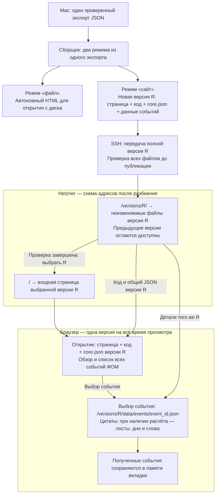

# План выкатки дашборда покрытия на Hetzner

Составлен 2026-11-05. Обновлён 2026-11-06 после проверки плана и действующего кода.

## Решение и текущие границы

**Дашборд публикуется для всех желающих, без логина и пароля.**
Для этого достаточно нынешнего HTML-файла и его сжатой копии.
Расчёты остаются на Mac; сервер раздаёт готовый результат по HTTPS.
Разбиение данных, подключение публикации к Dagster и перенос обработки на сервер можно отложить.

- Отдельный сервер запросов к базе сейчас не нужен. dbt считает показатели заранее, а браузер
  переключает виды и фильтрует готовые данные. Такой способ работает и с несколькими JSON-файлами.
  Сервер вычислений стоит обсуждать, когда появится нужный расчёт, который браузер не сможет выполнить
  на доступных ему данных.
- На Mac уже есть ручная задача Dagster `static_refresh`: проверка входов → загрузка DuckDB →
  `dbt build` с тестами → копия базы для Metabase. Экспорт JSON и сборка HTML пока запускаются отдельно.
  Расписания нет; см. [docs/dagster.md](dagster.md).
- Neo хранит векторы Qwen3 и участвует в подготовке новых сопоставлений постов с событиями.
  Для пересборки сайта из уже готовых наборов сопоставлений Neo и векторы не нужны.
- Metabase остаётся отдельным локальным потребителем данных. На сайт выкладываем наш HTML.
- Для сервера без подходящего веб-сервера предлагается Caddy: раздача файлов и автоматический HTTPS.
  Если сайты уже обслуживает другой веб-сервер, сначала проверяем возможность использовать его.
  Установку Caddy не считаем обязательной до проверки сервера.

Для текущей настройки владелец выбрал существующий `m4-pilot`; новый сервер не покупаем.
DNS и HTTPS подготовлены и проверены. Владелец подтвердил публикацию самого дашборда без пароля.
Первоначальный закрытый показ больше не является выбранным режимом доступа.

**Опубликовано 2026-11-06:** `https://askmedia.news`, версия `20261106T184425Z-30cc1f6d`.
Открытие страницы не требует авторизации. Опубликован основной `coverage_dashboard.html`, собранный
из свежего шаблона Claude: дизайн из [PR №5](https://github.com/alex-badin/events_coverage/pull/5)
и исправления подписей из [PR №6](https://github.com/alex-badin/events_coverage/pull/6), исходная ревизия `3d1b180`.
Дизайн включает общую таблицу обзора и недели, колонку ФОМ, относительные цвета и выбор периода.
Экспорт данных не менялся. Шаблон сохранён в `dashboard/coverage_dashboard_template.html`;
временный файл `_pr5` больше не нужен для повторения этой сборки.

## Выбранное размещение: существующий сервер — 2026-11-06

**Для нынешнего дашборда отдельный сервер не требуется.** После вопроса о более простом решении
проверен уже оплаченный `m4-pilot`: доступно 7 080 МиБ памяти и 62 ГБ диска, средняя нагрузка за минуту — 0,08.
Это состояние на момент проверки 2026-11-06, а не обещание постоянного запаса.
Для небольшой раздачи готовых файлов ресурсов достаточно; Caddy уже установлен.

Владелец подтвердил открытый сайт `askmedia.news` на существующем сервере.
Дополнительная аренда машины не потребуется. Текущие расходы на сервер и DNS сохраняются;
превышение включённого трафика оплачивается отдельно.

Текущий M4 обслуживается через Cloudflare Tunnel: Caddy слушает `127.0.0.1:8080`,
приложение — `127.0.0.1:8000`. Этот блок Caddy сохранён байт в байт; добавлен только импорт отдельного сайта.
Для нового сайта Caddy теперь слушает 80/443. Hetzner Firewall уже разрешал оба порта для IPv4 и IPv6;
его четыре правила не менялись. SSH, UFW и настройки приложения M4 также не менялись.

Что выполнено:

- [`scripts/prepare_dashboard_host.sh`](../scripts/prepare_dashboard_host.sh) применён к выбранному серверу.
  Он проверил полную конфигурацию Caddy до reload и сохранил исходные файлы для отката.
- [`configs/deploy/askmedia.Caddyfile`](../configs/deploy/askmedia.Caddyfile) задаёт отдельный открытый сайт.
  Он не содержит авторизацию и не запрашивает пароль. Публичная конфигурация применяется при выкладке.
- Ссылка `current` указывает на `/var/www/coverage/releases/20261106T184425Z-30cc1f6d`.
  В версии находятся только `index.html` и `index.html.gz`.
  Предыдущий открытый дашборд `20261106T164622Z-6f47ff32` сохранён для отката.
- Пароль первоначальной заглушки больше не используется публичной конфигурацией.
  Старый файл с паролем не переносится в папку сайта или в репозиторий.
- Резервная копия и журналы проверок находятся на сервере в
  `/root/events-coverage-backups/setup-20261106T141434Z.wvvEvX`.
- После применения Caddy и `cloudflared` активны. Входная страница M4 на локальном порту возвращает прежний `302`.
  Это проверка доступности входной страницы, а не всех функций приложения.
- Внешний HTTP-запрос с именем `askmedia.news` возвращает `308` на HTTPS.
  Получен сертификат Let's Encrypt для `askmedia.news`, действующий до 2027-02-04.
  Проверка сертификата и имени домена успешна; проверка TLS не отключалась.
- Внешние запросы к странице и к `/index.html.gz` возвращают `200` без `WWW-Authenticate`.
  Страница передаётся с `Content-Encoding: gzip`; распакованное содержимое совпадает с локальным HTML.
  HTML — 43 349 941 байт, gzip — 5 559 500 байт.
- Внешний IPv4 проверен с Mac через обычный DNS. При первой публичной выкладке внешний IPv6 проверен точкой Globalping:
  адрес совпал с AAAA, проверка сертификата успешна, ответ без пароля — `200`.
  [Результат IPv6-проверки публичной версии](https://api.globalping.io/v1/measurements/2NHusGU4MvucYt6XP00021SHf).
  Пароли сервису проверки не передавались.
- Для нового дизайна локально проверены выбор года, таблица недели, фильтр группы, справка
  и событие без расчёта с цитатами ФОМ. На публичном сайте проверены новый дизайн, обзор, неделя,
  выбор года и фильтр группы. Ошибок JavaScript при этих действиях не было.
  Основной блок Caddy M4 не изменился, локальная входная страница M4 возвращает прежний `302`.

Резервная копия нынешней выкладки находится в
`/root/events-coverage-backups/deploy-20261106T184425Z-30cc1f6d`:
`site.before` — прежний блок сайта, `current.before` — прежняя цель ссылки.
При сбое скрипт возвращает обе настройки и перечитывает проверенную конфигурацию Caddy.
Ручной откат использует эти же файлы; остальной `/etc/caddy/Caddyfile` менять не требуется.
Текущий откат вернёт предыдущий открытый дашборд `20261106T164622Z-6f47ff32`.
Резервная копия самой первой публикации сохранена отдельно в
`/root/events-coverage-backups/deploy-20261106T164622Z-6f47ff32`; она относится к первоначальной закрытой заглушке.
Отдельная машина остаётся запасным вариантом; подготовленный cloud-init к `m4-pilot` не применяется.

## Запасной вариант: подготовленный заказ нового сервера — 2026-11-06

Форма нового сервера заполнена до кнопки `Create & Buy now`; покупка не выполнена.
Этот вариант сохраняется для выбора владельца, а не является необходимым условием публикации.
Storage Box для резервных копий не заменяет сервер с Linux.

| Параметр | Выбор | Причина |
|---|---|---|
| Тариф | CPX02: 1 AMD vCPU, 1 ГБ памяти, 20 ГБ диска | Сервер раздаёт готовые файлы; расчётов и базы на нём нет |
| Расположение | Helsinki, `hel1` | Доступный европейский регион |
| ОС | Ubuntu 24.04 LTS | Поддерживаемая стабильная версия с обычными пакетами Linux |
| Имя | `events-coverage` | Назначение видно в списке ресурсов |
| Сеть | Публичные IPv4 и IPv6, без частной сети | Доступ зрителям и с Mac; IPv4 нужен и для сетей без IPv6 |
| Вход по SSH | Существующий ключ `m4-pilot-mac`; отдельный пользователь `deploy` в сценарии подготовки | Пароли для SSH не нужны; закрытый ключ остаётся на Mac |
| Веб-адрес | **`askmedia.news` в корне**, без поддомена | После обсуждения выбран прямой адрес отдельного проекта |
| Дополнительные услуги | Без Volumes, Load Balancer и платных Backups | Готовые файлы и сценарий подготовки сохраняются локально |
| Сетевой экран | UFW на новом сервере: только входящие TCP 22, 80, 443 | Существующий Firewall другого сервера не меняется |
| Первая настройка | [`configs/deploy/hetzner-cloud-init.yaml`](../configs/deploy/hetzner-cloud-init.yaml) | Встроенный cloud-init выполнит сценарий при первом запуске после покупки |

Цена, показанная консолью Hetzner: **$8,09 в месяц без НДС** — $7,49 за сервер и $0,60 за IPv4.
Цена и наличие могут измениться до покупки. В проверенной форме CX23 и CAX11 не выбирались:
консоль сообщала об отсутствии доступного варианта. CPX12 стоил $13,49 без IPv4;
доплата за память для нынешней раздачи файлов не нужна.

Cloud-init — встроенный механизм подготовки Linux, а не новая система сборки проекта.
Он нужен, чтобы установка Caddy и создание папок повторялись из сохранённого файла.
Простая альтернатива — выполнить те же команды вручную после покупки. Docker для этого не требуется.
Пока сервер не куплен, сценарий существует только как подготовленная конфигурация: ОС, SSH и HTTPS ещё не проверены.
Этот сценарий предназначен **только для новой машины**. Не применять его к `m4-pilot`:
он устанавливает свою конфигурацию Caddy и параметры ОС вместо существующих.

### Домен в AWS

Регистрация домена остаётся в AWS. Публичная проверка DNS подтвердила серверы имён Route 53:
`ns-1555.awsdns-02.co.uk`, `ns-810.awsdns-37.net`, `ns-376.awsdns-47.com`, `ns-1432.awsdns-51.org`.
На момент проверки у корня `askmedia.news` не было ответов A и AAAA.
Это проверка публичного DNS, а не аудит всех записей зоны в аккаунте AWS.

Для выбранного `m4-pilot` адреса уже известны: IPv4 `159.69.252.89`, IPv6 `2a01:4f8:c016:3da6::1`.
Подготовлены только эти добавления к корню домена, TTL 300 секунд:

| Имя | Тип | Значение |
|---|---|---|
| `askmedia.news` | A | `159.69.252.89` |
| `askmedia.news` | AAAA | `2a01:4f8:c016:3da6::1` |

После входа владельца изменения применены в существующей публичной зоне `Z03237923NBMSHY4360QD`.
До изменения в зоне были только NS и SOA. Обе служебные записи сохранены;
созданы только A и AAAA из таблицы. Зона `letsaskmedia.com` не менялась, новая платная зона не создавалась.

Изменение `C0408182231LGZD13J6N6` в AWS получило статус `INSYNC` 2026-11-06.
Серверы Route 53 и Google DNS возвращают оба новых адреса с TTL 300.
Сервер видит новые записи и получил сертификат. Первоначальная заглушка проверена по HTTPS;
для опубликованного дашборда авторизация не используется.

Первоначальный старый ответ DNS мобильного подключения Mac обновился к публичной выкладке.
Обычный DNS на Mac возвращает оба адреса, и браузер открывает сайт. Настройки сети Mac для этого не менялись.

Сведения о первоначальных записях и подтверждение AWS сохранены локально в
`outputs/hetzner_setup/route53-before.txt`, `route53-after.txt` и `route53-change-status.txt`.
Текущие отчёты: `public-http-checks.json`, `public-ipv6-check.json`, `last-deploy.json`, `setup-status.json`.
Файлы `https-checks.json` и `ipv6-external-check.json` относятся к прежней закрытой заглушке.
Зависимости проекта не менялись; временный SDK использовался только для проверки локальных профилей до входа в консоль.

Откат DNS: если A и AAAA всё ещё содержат значения из таблицы, удалить только эти две добавленные записи.
NS и SOA оставить прежними. Новый сервер не куплен и для выбранного размещения не требуется.

### Доступ зрителя

Адрес — `https://askmedia.news`. Опубликованный дашборд доступен всем без логина и пароля.
Короткими ссылками после `#` можно делиться: они открывают выбранную неделю или событие.

## Вся схема первой выкладки

Сплошные стрелки показывают путь очередной сборки сайта. Пунктирная ветка нужна только при подготовке
новых сопоставлений для исследования, а не при каждой публикации.

```mermaid
flowchart TB
    MATCH["Mac + Neo: подготовка новых сопоставлений<br/>Отдельная задача при расширении исследования"]

    subgraph MAC["1. Mac — ручная пересборка"]
        INPUTS["Новости + события ФОМ + группы СМИ<br/>Готовые наборы сопоставлений"]
        CHECK["Проверка читаемости входных файлов"]
        DB["DuckDB: загрузка таблиц<br/>dbt: расчёт показателей + тесты"]
        JSON["Экспорт dashboard_data.json"]
        HTML["Сборка coverage_dashboard.html<br/>Страница + код + данные в одном файле"]
        PACK["Новая временная папка<br/>index.html + index.html.gz"]
        INPUTS --> CHECK --> DB
        DB -->|"Успешная сборка и проверки"| JSON
        JSON --> HTML --> PACK
    end

    subgraph SERVER["2. Hetzner — хранение и публикация"]
        RELEASE["Новая папка releases/R<br/>R — уникальная версия выкладки"]
        VERIFY["Проверка загруженных файлов"]
        CURRENT["Переключение ссылки current на R<br/>Предыдущая версия сохранена для отката"]
        WEB["Веб-сервер: Caddy или существующий"]
        RELEASE --> VERIFY --> CURRENT --> WEB
    end

    subgraph USER["3. Браузер зрителя"]
        PAGE["Любой зритель получает HTML по HTTPS<br/>При поддержке gzip — сжатую копию"]
        VIEW["Распаковывает страницу и показывает дашборд<br/>Фильтры и переходы работают на полученных данных"]
        PAGE --> VIEW
    end

    MATCH -. "Готовые наборы сопоставлений" .-> INPUTS
    PACK -->|"rsync через SSH: только два файла"| RELEASE
    WEB --> PAGE
```



Что обновляется и где:

| Место | Что меняется при обновлении | Что запускает обновление |
|---|---|---|
| Mac: входные данные | Новые подготовленные данные, группы или наборы сопоставлений, если они появились | Отдельная работа с данными; первая выкладка использует существующие входы |
| Mac: рабочая база | DuckDB получает исходные таблицы; dbt пересчитывает показатели и проверяет их | Ручной запуск `static_refresh` либо команд из следующего раздела |
| Mac: файлы сайта | Новый JSON, новый HTML и соответствующая ему `.gz`-копия | Экспорт, сборка и упаковка |
| Hetzner | Новая папка версии; после проверки ссылка `current` указывает на неё | Отдельная команда публикации с Mac |
| Браузер | Получает опубликованный снимок при открытии или перезагрузке страницы | Действие зрителя; уже открытая страница сама не обновляется |

Через SSH не передаются архив новостей, DuckDB, векторы, `.env` или весь репозиторий.
Сервер не запускает dbt и не вызывает платные модели. Открытие события в браузере тоже не запускает расчёт.

## Что нужно для первой выкладки

### 1. Выбрать адрес и проверить сервер

Выбран корень `askmedia.news`. Владелец подтвердил публичный доступ к дашборду,
включая существующие отрывки постов и цитаты ФОМ из экспорта.

1. Проверить ОС сервера, занятость портов 80/443 и действующий способ обслуживания сайтов.
   Добавить сайт в существующую конфигурацию, если она подходит. Не заменять её вслепую.
2. Настроить DNS корня `askmedia.news` на сервер. Для HTTPS открыть нужные порты в действующих межсетевых экранах,
   включая Hetzner Firewall, если он используется.
3. Если выбран Caddy, установить поддерживаемую версию по
   [официальной инструкции](https://caddyserver.com/docs/install). На выбранном сервере Caddy уже установлен.
4. Подготовить `/var/www/coverage/releases`. Пользователь выкладки должен иметь право писать туда,
   а веб-сервер — читать файлы и проходить по родительским папкам.

Папки первой выкладки:

```text
/var/www/coverage/
├── releases/
│   ├── R1/
│   │   ├── index.html
│   │   └── index.html.gz
│   └── R2/
│       ├── index.html
│       └── index.html.gz
└── current -> releases/R2
```

`R1` и `R2` обозначают уникальные имена версий. Ссылка `current` выбирает версию, доступную зрителю.
На сервере нужны только готовые файлы сайта и настройка веб-сервера.

### 2. Настроить открытый сайт по HTTPS

Публичный блок сайта подключён из `/etc/caddy/sites/askmedia.news.caddy`.
Существующий блок M4 остаётся в `/etc/caddy/Caddyfile`. Раздача опубликованной версии выглядит так:

```caddyfile
askmedia.news {
    root * /var/www/coverage/current
    file_server {
        precompressed gzip
    }
}
```

Перед применением проверить конфигурацию командой
`sudo caddy validate --config /etc/caddy/Caddyfile --adapter caddyfile`.
Для установки через systemd применить проверенную конфигурацию командой `sudo systemctl reload caddy`.

`precompressed gzip` позволяет отдать готовый `.gz`, если браузер принимает gzip.
Если сжатой копии нет, эта конфигурация отдаёт обычный файл; сжатие на лету здесь не включено.
Пароль не требуется. Подробнее:
[готовые сжатые файлы](https://caddyserver.com/docs/caddyfile/directives/file_server),
[автоматический HTTPS](https://caddyserver.com/docs/automatic-https).

### 3. Подготовить и проверить локальную сборку

Из корня репозитория выполнить шаги по порядку. После неудачного шага не переходить к следующему.
Перед загрузкой и dbt закрыть отдельные соединения с рабочей DuckDB, чтобы не получить блокировку файла.

```sh
.venv/bin/python scripts/check_inputs.py
.venv/bin/python scripts/load_warehouse.py
(cd dbt && ../.venv/bin/dbt build)
.venv/bin/python scripts/export_dashboard_data.py
.venv/bin/python dashboard/build_dashboard.py
```

Проверка входов подтверждает, что исходные файлы читаются. Загрузчик обновляет таблицы DuckDB.
dbt строит показатели и запускает тесты. Экспорт сохраняет снимок показателей в JSON.
Сборщик соединяет этот JSON и шаблон страницы в `outputs/dashboard_exports/coverage_dashboard.html`.

Для первых трёх шагов также можно вручную использовать существующий `static_refresh`;
он дополнительно обновляет локальную копию базы для Metabase. Экспорт и сборку HTML затем выполнить отдельно.
Не запускать оба способа пересборки подряд без причины.

Продолжать после успешного dbt без неразобранных предупреждений; текущие предупреждения описаны
в [dashboard/README.md](../dashboard/README.md). Открыть HTML локально и проверить обзор, неделю,
измеренное событие с постами и событие без рассчитанного покрытия с цитатами респондентов.

### 4. Повторяемая публикация

[`scripts/deploy_dashboard.sh`](../scripts/deploy_dashboard.sh) публикует один подготовленный HTML и его `.gz`-копию.
Разбиение JSON для этого не требуется. Скрипт не запускает сбор данных, платные вызовы или пересборку базы.

Требования к скрипту:

1. Независимо от текущей папки найти корень проекта и подготовленный HTML. Проверить, что HTML читается и не пуст.
2. Прочитать `DEPLOY_HOST` из локального `.env` без вывода остальных значений. Проверить, что адрес задан.
   Не отправлять `.env` на сервер. Не подставлять значения из файла в исполняемые строки команд.
3. Останавливаться при любой ошибке, в том числе при ошибке копирования, SSH или проверки файлов.
   Для zsh включить `set -euo pipefail` и явно проверять операции, для которых одного этого режима недостаточно.
4. Создать уникальный идентификатор версии `R` и новую временную папку через `mktemp -d`.
   Скопировать HTML как `index.html` и создать `index.html.gz`. Удалять временную папку при выходе.
5. Проверить сжатую копию через `gzip -t`. Сравнить распакованное содержимое с `index.html`;
   ошибка сравнения должна остановить публикацию.
6. Передать через `rsync` по SSH только эти два файла в новую папку `/var/www/coverage/releases/R/`.
   Уже опубликованную папку не перезаписывать. Сохранить ожидаемые SHA-256 обоих файлов локально
   и сравнить с хэшами на сервере после передачи.
7. Запомнить предыдущую цель `current`. Только после успешной передачи и проверки создать временную ссылку
   на новую версию и заменить ею `current` через атомарное переименование в той же папке.
   Зритель должен видеть либо предыдущую, либо новую готовую версию.
8. Проверить сайт по HTTPS. При неудаче вернуть предыдущую ссылку и сообщить об ошибке.
   Если это первая выкладка, сообщить, что предыдущей версии для отката ещё нет.
   Вывести идентификатор новой версии и сведения для отката.

Постоянную `/tmp/coverage_site` не использовать: повторный `gzip -k` оставляет старую `.gz`-копию,
если она уже существует. Сжатая копия должна всегда соответствовать HTML той же сборки.

Команда с явным выбором уже настроенного сервера:

```sh
DEPLOY_HOST=m4-pilot zsh scripts/deploy_dashboard.sh
```

### 5. Проверить первый показ и откат

При каждой выкладке проверить:

- По адресу `https://askmedia.news` работает HTTPS. Без логина и пароля запрос к странице и прямой запрос к
  `/index.html.gz` получают `200`; заголовок `WWW-Authenticate` отсутствует.
- Открывается нужная версия. При запросе с `Accept-Encoding: gzip` сервер
  возвращает `Content-Encoding: gzip`, а распакованный ответ совпадает с локальным HTML.
- В браузере работают обзор, переход по прямой ссылке `#/week/...`, кнопка «Назад», фильтры и просмотр постов.
  События без рассчитанного покрытия сохраняют свои цитаты и обозначение отсутствия расчёта.
- Новая версия и её сжатая копия содержат одну сборку; предыдущая папка и конфигурация сохранены для отката.
  Код отката проверен до первой публикации. Намеренный сбой на работающем сайте не имитировался.
  Старые папки пока удаляются вручную, после проверки новой версии и сохранения версии для отката.
- Перед решением о разбиении отдельно измерить время до рабочего обзора на обычном соединении и слабом устройстве.
  Первая публикация включала проверку браузера, но не сравнительный тест производительности устройств.

Навигация после `#` обрабатывается браузером. Специальные перенаправления для адресов недель не нужны.
Первая публикация передаёт весь снимок сразу; переход к событию не догружает JSON с сервера.

## Что можно отложить

| Работа | Когда возвращаться | Зачем она нужна |
|---|---|---|
| Разбиение HTML и данных | После проверки первой версии, если большой файл заметно мешает просмотру | Уменьшить начальную загрузку и разбор данных браузером |
| Экспорт и сборка в графе Dagster | Когда ручное повторение шагов становится неудобным | Видеть зависимости и результат сборки в одном месте |
| Отдельная задача публикации в Dagster | Когда готов и проверен скрипт выкладки | Публиковать выбранную проверенную сборку отдельным действием |
| Расписание | После решения, какие новые данные должны регулярно появляться | Автоматизировать уже проверяемое обновление |
| Перенос сборки на сервер | Когда работа без включённого Mac становится нужной | Собирать сайт из подготовленных входов на другой машине |
| Автоматический сбор и сопоставление новых данных | Отдельная следующая фаза исследования | Расширять измеренный период, а не просто публиковать готовый снимок |

### Позже: разбиение данных с сохранением версии

Экспорт остаётся один. `dashboard/build_dashboard.py` получает два режима:

- «файл» — нынешний автономный HTML для открытия двойным кликом;
- «сайт» — страница, общий JSON и данные отдельных событий. Страница загружает детали по мере надобности.

Будущая схема отличается от первой выкладки только упаковкой сайта и загрузкой данных браузером:



Обязательные условия этого этапа:

1. **Версия входит в адрес каждого загружаемого файла.** Например, `/versions/R/app.js`,
   `/versions/R/data/core.json` и `/versions/R/data/events/<event_id>.json`.
   Корневая страница указывает на конкретный `R`. Веб-сервер должен отдельно обслуживать `/versions/`,
   чтобы файлы прошлых версий оставались доступны после переключения входной страницы.
   Это изменение относительно первой схемы с корнем только на `current`, а не готовое свойство её конфигурации.
   Все файлы опубликованных версий доступны без авторизации, как и корневая страница.
2. **Открытая вкладка продолжает использовать свою версию.** Иначе обзор, открытый до публикации,
   может получить новые детали события и показать смесь двух снимков.
   Корневую страницу браузер перепроверяет при новом открытии; файлы версии не перезаписываются.
   Старые версии хранятся весь заявленный срок поддержки открытых вкладок. После удаления старой версии
   страница предлагает перезагрузиться, а не молча подменяет детали новой версией.
3. **Цитаты сохраняются для всех открываемых событий.** Сейчас `week_events` содержит и события
   без рассчитанного покрытия. Для них создать файл деталей с цитатами либо загружать цитаты по неделе.
   Не ограничивать набор файлов списком измеренных `events`.
   В действующем экспорте исходный `quote_examples` уже превращается в поле `quotes`.
4. В `core.json` оставить недели, темы, внимание к темам, итоги покрытия, сведения о событиях,
   список событий по неделям и нужные обзору поля `groups`.
   Остальные поля `groups`, посты, покрытие по дням, слова и цитаты перенести в детали.
   Итоги покрытия брать из готовых таблиц dbt; не складывать совпавшие посты разных событий в браузере.
5. Показывать состояние загрузки и понятную ошибку. При быстром переходе между событиями поздний ответ
   предыдущего запроса не должен подменить текущее событие. Успешно загруженные детали держать в памяти.
6. Проверить равенство цифр и цитат в двух режимах, прямые ссылки и события без расчёта.
   Отдельно проверить сценарий: открыть обзор версии R1 → опубликовать R2 → открыть событие в старой вкладке.
   Детали должны остаться из R1. Проверить ошибку загрузки и откат входной страницы.
7. Измерить начальную загрузку, самый большой файл события и общий объём файлов, включая `.gz`.
   Записать результат в `dashboard/README.md`. Прежняя оценка по числу измеренных событий
   не учитывала отдельные файлы цитат для остальных событий и не является целевым размером.

### Позже: Dagster и перенос обработки

Экспорт и сборку можно добавить в локальный граф после успешного `dbt build` и проверки тестов.
Публикацию следует выбирать отдельной задачей, например `publish_dashboard`, которая использует проверенную
сборку и скрипт выкладки. Учебный или проверочный `static_refresh` не должен сам менять опубликованный сайт.
Задача публикации не запускает сбор новостей или платное сопоставление.

Расписание, перенос сборки и получение новых данных — три отдельных решения:

- Для сборки сайта из готового JSON на сервере достаточно файла экспорта, шаблона и сборщика страницы.
- Для пересчёта dbt на сервере нужны соответствующие исходные таблицы или файлы и готовые сопоставления.
  Qwen3-векторы этому этапу не нужны.
- Для обработки новых событий потребуется отдельно организовать сбор, подготовку текста, поиск кандидатов
  и сопоставление. Векторы могут оставаться на Neo; их перенос не является обязательным условием.
  Такая обработка требует своего бюджета, правил повторного запуска, контроля ошибок и решения о расписании.

Эти работы не входят в первую публикацию. Нынешняя фаза остаётся историческим дашбордом покрытия;
извлечение фрейминга и нарративов не расширяется.

## Что получает зритель и какие данные становятся доступны

В первой версии браузер получает весь HTML-снимок. После разбиения браузер сначала получает общий обзор,
затем запрашивает детали выбранных событий. Отложенная загрузка уменьшает начальную передачу,
но не мешает зрителю скачать остальные файлы сайта, если у зрителя есть доступ.

Посетитель с доступом может сохранить всё, что раздаёт сайт, включая поля, скрытые интерфейсом:
отрывки Telegram-постов до 500 символов, до пяти постов на группу и событие, источник, ID сообщения,
время, просмотры, пересылки, оценку соответствия, группы СМИ и примеры ответов респондентов ФОМ.
Архив новостей и рабочая база на сайт не выкладываются.

| Защита | Что даёт | Чего не даёт |
|---|---|---|
| Пароль по HTTPS | Закрывает страницу и все файлы сайта от посетителя без пароля | Получатель пароля может сохранить и переслать данные |
| Удаление текстов постов из экспорта | Тексты не раздаются сайтом | Просмотр этих текстов на странице исчезает |
| Скрытие блока интерфейса | Меняет только вид страницы | Не защищает данные, которые уже раздаются |
| Секретная ссылка | Усложняет случайное обнаружение | Не ограничивает доступ и не гарантирует отсутствие в поиске |
| Запрет индексации | Просит поисковые системы не включать страницы в выдачу | Не заменяет пароль и не защищает файлы от скачивания |

Классификация источников по группам уже опубликована в `configs/media_groups.yaml`.

## Справка о нынешней сборке

Локальная проверка 2026-11-06: HTML занимает 43 349 941 байт, JSON — 43 264 751 байт;
список `events` содержит 637 событий с измеренным покрытием. Это снимок текущих файлов, а не скорость загрузки сайта.
Gzip опубликованной версии — 5 559 500 байт; фактический размер нужно записывать для каждой новой сборки.
SHA-256 HTML: `4268a0fd75aa9580f645eac4b0f44ede37ab9fd28c4a95c49bb48745c94d3ba4`.
Сжатие уменьшает передачу по сети, но браузеру всё равно нужно разобрать распакованный HTML и данные.

## Что не входит в публикацию

Разбиение данных, расписание Dagster и обработка новых событий остаются следующими отдельными решениями.
Для текущего показа используются существующий экспорт и действующий шаблон; платные модели не вызываются.
